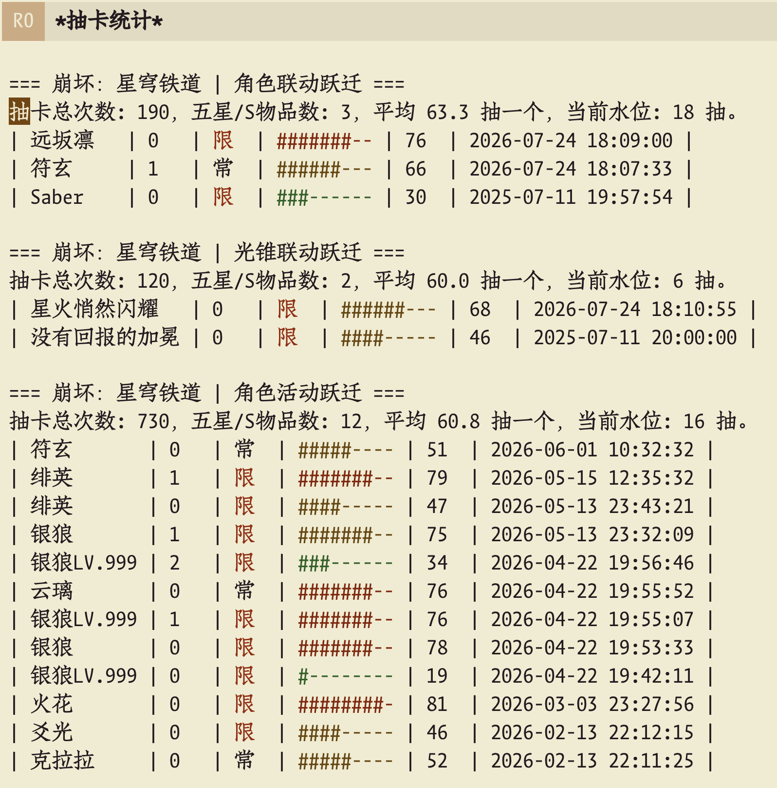
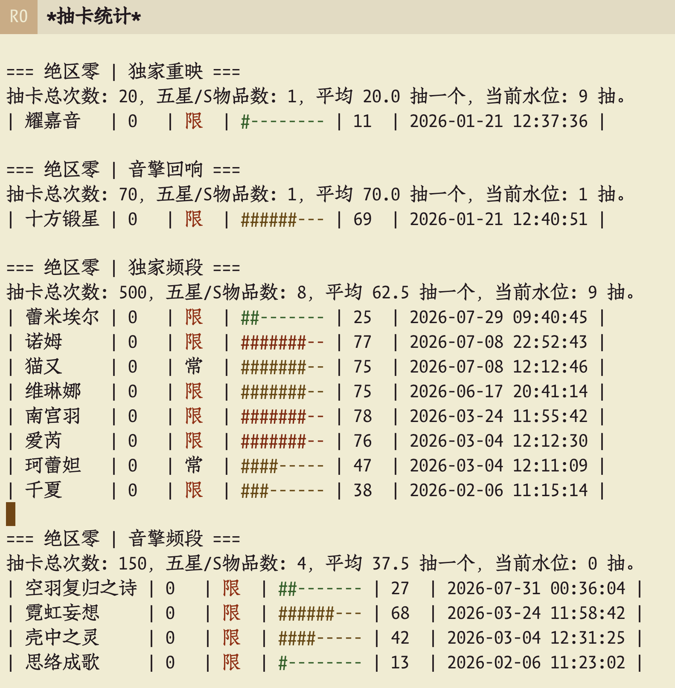

* hoyogacha.el
Emacs 中的米哈游抽卡记录管理器

* 目前功能
- [X] 支持国服相关数据
- [X] 获取抽卡记录链接
- [X] 自动抓取祈愿记录
  - [X] 拼接记录链接
  - [X] 实现轮询导入
- [X] 导入UIGF v4.1+ 标准的 json 数据
- [X] 保存数据到本地，以 UIGF v4.1+ 标准
- [X] 展示统计 buffer

* 示例图

* 使用例
** 依赖

本插件依赖 [[https://github.com/alphapapa/plz.el][plz]]：一个 Emacs 的 HTTP 客户端库。

通过下面推荐的 TomoELPA 或 =:vc= 方式安装时，=plz= 会作为包依赖自动安装，无需手动处理。
** 安装与配置

*** 推荐：从 TomoELPA 安装

TomoELPA 是作者自建的 ELPA 仓库。添加归档源后，用 =use-package= 即可完成安装与配置。将下面这段完整的配置加入您的 Emacs 配置文件（如 =init.el= ）：

#+begin_src elisp
(require 'package)
(add-to-list 'package-archives
             '("tomoelpa" . "https://tomoemami.github.io/tomoelpa/snapshots/") t)
(package-initialize)
(unless package-archive-contents
  (package-refresh-contents))
(use-package hoyogacha
  :ensure t
  :demand t
  :custom
  ;; 抽卡记录的本地保存路径，请按需修改。
  (hoyogacha-data-save-file "/path/to/your/data.json"))
#+end_src

几点说明：

- =package-archives= 中的归档名 =tomoelpa= 可以自行命名，只要不与其它归档重名即可；URL 指向 TomoELPA 的 =snapshots= 频道。
- 首次启动时若提示找不到 =hoyogacha= ，先执行一次 =M-x package-refresh-contents= ，再重启 Emacs。
- 想使用稳定版而不是快照版时，把 URL 中的 =snapshots= 换成 =releases= 即可。
- 安装完成后不需要再手动 =require 'hoyogacha= ，=use-package= 会负责加载。

*** 可选：使用 use-package 的 =:vc= 关键字安装

Emacs 30.1 及以上版本内置的 =use-package= 支持 =:vc= 关键字，可以直接从 Git 仓库拉取并安装源码，适合想跟进最新代码的用户：

#+begin_src elisp
(use-package hoyogacha
  :demand t
  :vc (:url "https://github.com/TomoeMami/hoyogacha.el.git"
            :rev :newest)
  :custom
  (hoyogacha-data-save-file "/path/to/your/data.json"))
#+end_src

- =:url= 指定仓库地址；如果您已配置好 GitHub 的 SSH key，也可以改用 =git@github.com:TomoeMami/hoyogacha.el.git= 。
- =:rev :newest= 表示跟踪默认分支的最新提交。首次加载时 =use-package= 会自动克隆仓库并构建安装，之后可用 =M-x package-vc-upgrade= 更新。
- 这种方式与上面的 TomoELPA 方式二选一即可，不要同时配置。

*** 手动安装（不推荐）

将 =hoyogacha.el= 文件放置到您的 Emacs =load-path= 中，并确保已安装 =plz= ，然后在配置文件中添加：

#+begin_src elisp
(use-package plz :ensure t)
(require 'hoyogacha)
#+end_src
** 使用方法
配置用于存储数据文件的路径：
#+begin_src elisp
(use-package hoyogacha :demand t
  :custom
  (hoyogacha-data-save-file "/path/to/your/data.json"))
#+end_src

可选：配置自动导入的路径，启动时会从该路径中导入符合 UIGF 标准的 json 文件：
#+begin_src elisp
(use-package hoyogacha :demand t
  :custom
  (hoyogacha-data-save-file "/path/to/your/data.json")
  (hoyogacha-data-import-dir "/path/to/your/import/dir"))
#+end_src

可选：指定绝区零安装路径。
星穹铁道会自动扫描获取游戏安装路径，因此不需要指定。
#+begin_src elisp
(use-package hoyogacha :demand t
  :custom
  (hoyogacha-data-save-file "/path/to/your/data.json")
  (hoyogacha-data-import-dir "/path/to/your/import/dir")
  (hoyogacha-zzz-install-dir "D:/Apps/ZenlessZoneZero Game/ZenlessZoneZero_Data"))
#+end_src

可选：设置 UID 的展示名称，在下图这个例子中会将 =114514= 这个 UID 替换为 =野兽先生= ：
#+begin_src elisp
(use-package hoyogacha :demand t
  :custom
  (hoyogacha-data-save-file "/path/to/your/data.json")
  (hoyogacha-data-import-dir "/path/to/your/import/dir")
  (hoyogacha-zzz-install-dir "D:/Apps/ZenlessZoneZero Game/ZenlessZoneZero_Data")
  (hoyogacha-uid-aliases '(("114514" . "野兽先生"))))
#+end_src
设置好了这些之后直接 =M-x= 执行 =hoyogacha-show= 就行了，选择你需要处理的游戏。

拉取新记录在后台异步进行，不会阻塞 Emacs；可以先看到本地已有数据，拉取完成后统计 buffer 会自动刷新。中途可用 =M-x hoyogacha-cancel= 中止拉取（已拉取的部分仍会保存）。
** 已知问题
- 星穹铁道的 UBW 联动卡池抽卡记录链接与其他卡池不一样，因此打开 UBW 联动卡池抽卡记录时只能获取到联动卡池的抽卡记录，而打开其他卡池抽卡记录时能获取到其他抽卡记录。
* 参考项目
- https://github.com/lgou2w/HoYo.Gacha
- https://gist.githubusercontent.com/Star-Rail-Station/2512df54c4f35d399cc9abbde665e8f0/raw/get_warp_link_cn.ps1?cachebust=srs
- https://github.com/vikiboss/gs-helper
- https://github.com/Summer-Neko/NekoGame

